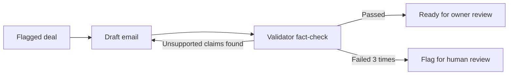

# Partner Ops Agent

An agentic workflow that automates the manual work of a partnerships team: triaging inbound partner opportunities, catching problems in the deal pipeline, and drafting fact-checked follow-up emails.

Built with Python, LangGraph, and LLMs (model-agnostic: runs on Groq or Claude with a one-line config change).

## What it does

**1. Inbound triage.** A rules-based scoring layer ranks each opportunity (deal value, partner type, company size, lead source) into Priority, Nurture, or Deprioritize. An LLM then explains each decision in plain English and suggests a next action.

**2. Pipeline hygiene.** Automated checks flag overdue follow-ups, stale deals, missing owners, Priority deals that haven't started, and incomplete records, ranked by severity.

**3. Fact-checked follow-up drafts.** For each flagged deal, an LLM drafts a follow-up email. A separate Validator agent checks the draft against the deal data and sends it back for a rewrite if it finds unsupported claims (invented meeting times, dates, prices, or attachments). Drafts that still fail after 3 attempts are flagged for human review.

**4. Dashboard.** A Streamlit app shows headline metrics, triage results, pipeline issues, and follow-up drafts with a full fact-check log.

## How the follow-up loop works



## Key design decisions

- **Rules decide, the LLM explains.** Scores and tiers come from transparent rules, so the same opportunity always gets the same result. The LLM writes the rationale but is told never to change the tier.
- **A separate Validator agent.** Prompt rules alone didn't stop the drafter from inventing details. A second agent with one narrow job (find unsupported claims) caught issues such as a draft treating the last contact date as the date a proposal was sent.
- **Drafts, not sends.** Every email goes to the deal owner for review. A human stays in the loop for anything sent to a partner.
- **Model-agnostic.** All LLM calls go through one helper (`src/llm.py`). Switching from Groq to Claude is a one-line change in `.env`.
- **Tested without the LLM.** Scoring, hygiene, and loop-routing logic are covered by 13 pytest tests. The loop tests use fake drafter and Validator functions, so they're fast, free, and deterministic.

## Project structure

```
app.py                  Streamlit dashboard
run_triage.py           Loads sample data and triages every opportunity
src/scoring.py          Rules-based triage scoring
src/triage.py           LLM rationale and next action
src/db.py               SQLite schema (opportunities, triage results, pipeline)
src/hygiene.py          Pipeline hygiene checks
src/followup.py         Follow-up email drafting
src/validator.py        Validator agent (fact-checker)
src/followup_graph.py   LangGraph draft-validate-rewrite loop
src/llm.py              Model selection (Groq or Claude)
tests/                  pytest tests
data/                   Sample opportunities and pipeline status (fictional companies)
```

## Run it locally

```bash
git clone https://github.com/esther-jk7/partner-ops-agent.git
cd partner-ops-agent
python3 -m venv .venv && source .venv/bin/activate
pip install -r requirements.txt
echo "GROQ_API_KEY=your_key_here" > .env
python run_triage.py
streamlit run app.py
```

Run the tests with `python -m pytest -v`.

## Roadmap

- Partner intelligence: monitor news on a partner watchlist and produce a fact-checked weekly briefing
- Scheduled runs with GitHub Actions
- Claude as the default model for demos

*All companies, people, and deals in the sample data are fictional.*
